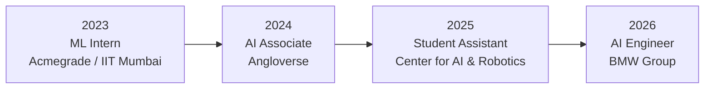
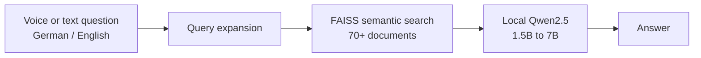
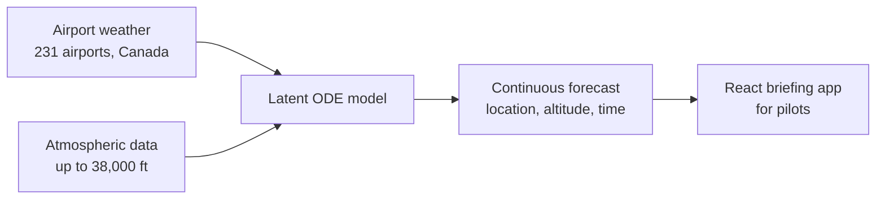

<!-- Profile README for github.com/riyazbiju/riyazbiju
     TODO before publishing: replace every "REPO_LINK" with the real repo URL. -->

---

## ▶️ Watch my 24-second intro

Click the video to open the full-quality MP4.

---

## 🧭 Quick read

<table>
<tr>
<td width="33%" valign="top">

### 📍 Now
Building AI at **BMW Group, Munich**. Multi-agent systems on a Neo4j knowledge graph for quality investigations. My Master Thesis is there too, on knowledge graphs and link prediction.

</td>
<td width="33%" valign="top">

### 🛠️ I do
Agents, GraphRAG, local LLMs and the full stack around them: data pipelines, APIs and the interface people actually use.

</td>
<td width="33%" valign="top">

### 🎯 Looking for
Full-time **AI Engineer** roles in Germany and across Europe. Available from **Dec 2026**.

</td>
</tr>
</table>

---

## 🛤️ My path

<b>What I did at each step</b>

 

| Role | What I did |
|:--|:--|
| **BMW Group** · 2026 → now | Built a multi-agent system on a Neo4j knowledge graph that finds root causes for quality issues |
| **Center for AI & Robotics** · 2025–26 | Built CAIRA, a local RAG assistant that answers in German and English |
| **Angloverse** · 2024–25 | Built the NLP pipeline behind an IELTS training platform, and grew international enrollment by 75% |
| **Acmegrade / IIT Mumbai** · 2023–24 | Built ML models and Power BI dashboards |

---

## 📊 Proof, in numbers

<table>
<tr>
<td align="center" width="20%"><h3>1.5B → 1.6M</h3>records narrowed for real-time use at BMW</td>
<td align="center" width="20%"><h3>~1 day → minutes</h3>to assign a root cause</td>
<td align="center" width="20%"><h3>−60%</h3>CAIRA response time</td>
<td align="center" width="20%"><h3>&gt;50%</h3>lower SKYBRIEF prediction error</td>
<td align="center" width="20%"><h3>3× smaller</h3>edge model, accuracy 94.6% → 96.7%</td>
</tr>
</table>

---

## 🚀 Flagship projects, side by side

<table>
<tr>
<td width="50%" valign="top">

### 🎙️ CAIRA
**A local voice and text assistant for university students**

Runs fully on local NVIDIA servers. Answers in German and English over 70+ documents.

• Sub-second retrieval, 60% faster responses 
• Query expansion for vague, multi-part questions 
• Session memory across a whole conversation

`FastAPI` `Gradio` `FAISS` `multilingual-e5-small` `Qwen2.5`

🔗 [Repo](REPO_LINK)

</td>
<td width="50%" valign="top">

### ✈️ SKYBRIEF
**Weather briefings for pilots**

A Latent ODE model that forecasts temperature, wind and visibility across location, altitude and time. I led a team of three and built the full stack.

• Error cut by more than half against two standard methods 
• 60–67% better on a real flight route 
• 231 airports in Canada, data up to 38,000 ft

`PyTorch` `Latent ODE` `Python` `React`

🔗 [Repo](REPO_LINK)

</td>
</tr>
</table>

<b>🔍 See how each one works</b>

 

**CAIRA**

**SKYBRIEF**

---

## 🧩 More things I've built

<b>Show all 5 projects</b>

 

| Project | What I built | Stack |
|:--|:--|:--|
| **[Edge AI PPE Detection](REPO_LINK)** | Pruned a MobileNet by ~69% (8.63 MB → 2.77 MB). Accuracy went up, and speed on a Raspberry Pi stayed the same. | `PyTorch` `MobileNet` `Raspberry Pi` |
| **[Explainable Pneumonia Detection](REPO_LINK)** | ResNet-18 on chest X-rays, with Grad-CAM and LIME to show where the model looks. | `PyTorch` `Grad-CAM` `LIME` |
| **[SignEase](REPO_LINK)** | Real-time sign language translation for inclusive meetings. Published in IJRAR (2024). | `CNN-LSTM` `MediaPipe` |
| **[β-VAE on CelebA](REPO_LINK)** | Face generation model that separates traits like head pose into adjustable controls. | `PyTorch` `VAE` |
| **[Prakrithi-Identifier](REPO_LINK)** | Ayurvedic constitution prediction, extended to skin disease detection with a camera. | `scikit-learn` `Computer Vision` |

---

## 🧰 Toolbox

<table>
<tr>
<td valign="top" width="50%">

**🤖 Agents and LLMs** 
LangChain · LangGraph · GraphRAG · Qwen · Llama · tool and skill interfaces

**🔎 Retrieval** 
FAISS · vector databases · semantic search · multi-hop reasoning

**🕸️ Graphs** 
Neo4j · Cypher · graph projections · TransE · ComplEx · R-GCN

</td>
<td valign="top" width="50%">

**⚙️ Backend and data** 
FastAPI · REST APIs · SQL · Oracle · Palantir Foundry · Docker · CI/CD

**📊 Dashboards** 
Power BI

**🌍 Languages** 
English (C1) · German (B1) · Malayalam · Tamil · Hindi

</td>
</tr>
</table>

---

## 🏆 Recognition

- 🥇 Finalist, **Medha V** Global AI Data Viz Hackathon (BMW Techworks India)
- 📄 **IJRAR 2024**, two papers: Ayurveda + AI survey (IIT Palakkad innovation finalist) and SignEase
- 🥈 **2nd Best Paper**, National Conference on Emerging Frontiers of Medicine and Technology
- 🎓 **Best Outgoing Student Award**, Holy Grace Academy of Engineering (2024)

---

## 📈 GitHub activity

---

## 💬 Let's talk

<table>
<tr>
<td width="50%" valign="top">

**Ask me about** 
• Multi-agent systems and GraphRAG 
• Running LLMs locally 
• Getting AI into real workflows

</td>
<td width="50%" valign="top">

**Happy to collaborate on** 
• Agent tooling 
• Knowledge graphs 
• AI for healthcare and accessibility

</td>
</tr>
</table>

> 🤖🤝👤 Still deciding whether to trust AI or humans, so I build AI that shows its work.

