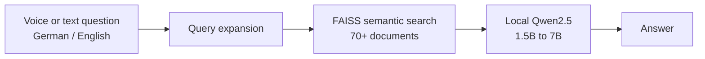
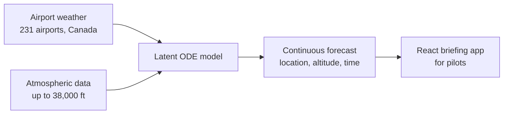

<!-- Profile README for github.com/riyazbiju/riyazbiju
     TODO before publishing: replace every "REPO_LINK" with the real repo URL. -->

**[⚡ 30-second summary](#-30-second-summary)** · **[📊 Numbers](#-by-the-numbers)** · **[🚀 Projects](#-featured-projects)** · **[🛠️ Stack](#%EF%B8%8F-tech-stack)** · **[💬 Contact](#-lets-talk)**

---

## 👋 Hi, I'm Riya

I'm an AI Engineer. I build agents and LLM workflows that solve real problems for real teams, then keep improving them after launch.

> 👇 **Click the arrows below to open sections.** Everything here expands.

---

## ⚡ 30-second summary

<b>Pick the path that fits you</b>

 

| If you are... | Start here |
|:--|:--|
| 🧑‍💼 **A recruiter** | Open **By the numbers** and **Experience at a glance** below |
| 🧑‍💻 **An engineer** | Open the **CAIRA** and **SKYBRIEF** diagrams in Featured projects |
| 🤝 **A collaborator** | Jump to **Let's talk** and tell me what you're building |

<b>🏭 Experience at a glance</b>

 

- **BMW Group, Munich.** Built a multi-agent system on a Neo4j knowledge graph for quality investigations. Now working on my Master Thesis there, on knowledge graphs and link prediction.
- **THWS, Würzburg.** Built CAIRA, a local RAG assistant that answers in German and English, by voice or text.
- **Master's project.** Led a team of three to build SKYBRIEF, a weather briefing tool for pilots.

---

## 📊 By the numbers

<b>Results from my projects (click to collapse)</b>

 

| | |
|:--|:--|
| **1.5B → 1.6M** | Records narrowed down for real-time use in the BMW pipeline |
| **~1 day → minutes** | Time to assign a root cause after the multi-agent system went live |
| **−60%** | End-to-end response time on CAIRA after tuning retrieval and chunking |
| **>50%** | Lower prediction error for SKYBRIEF compared to two standard forecasting methods |
| **3× smaller** | Edge AI model after pruning, with accuracy up from 94.6% to 96.7% |

---

## 🚀 Featured projects

<b>🎙️ CAIRA: a local voice and text assistant for university students</b>

 

Runs fully on local NVIDIA servers, answers in German and English, and works over 70+ documents. Built with FastAPI, Gradio, FAISS, multilingual-e5-small embeddings, and Qwen2.5 (1.5B to 7B).

- Reached sub-second retrieval and cut response time by 60%.
- Handled vague, multi-part questions with automatic query expansion.
- Kept session state across a whole conversation.

🔗 [Repo](REPO_LINK)

<b>✈️ SKYBRIEF: weather briefings for pilots</b>

 

A Latent ODE model that predicts temperature, wind, and visibility continuously across location, altitude, and time. Trained on data from 231 airports across Canada plus atmospheric data up to 38,000 ft. I led the team and built the full stack, from the Python model to the React app pilots use.

- Cut prediction error by more than half against two standard methods.
- Beat the older methods by 60–67% on a real flight route.

🔗 [Repo](REPO_LINK)

### 🧩 More projects

<b>⚡ Edge AI PPE Detection</b> · <code>PyTorch</code> <code>MobileNet</code> <code>Raspberry Pi</code>

 

Pruned a MobileNet by ~69% (8.63 MB → 2.77 MB). Accuracy went up from 94.6% to 96.7%, and speed on a Raspberry Pi stayed the same.

🔗 [Repo](REPO_LINK)

<b>🩻 Explainable Pneumonia Detection</b> · <code>PyTorch</code> <code>Grad-CAM</code> <code>LIME</code>

 

ResNet-18 on chest X-rays, with Grad-CAM and LIME to show where the model looks.

🔗 [Repo](REPO_LINK)

<b>🤟 SignEase</b> · <code>CNN-LSTM</code> <code>MediaPipe</code>

 

Real-time sign language translation for inclusive meetings. Published in IJRAR (2024).

🔗 [Repo](REPO_LINK)

<b>🧑‍🎨 β-VAE on CelebA</b> · <code>PyTorch</code> <code>VAE</code>

 

Face generation model that separates traits like head pose into adjustable controls.

🔗 [Repo](REPO_LINK)

<b>🌿 Prakrithi-Identifier</b> · <code>scikit-learn</code> <code>Computer Vision</code>

 

Ayurvedic constitution prediction, extended to skin disease detection with a camera.

🔗 [Repo](REPO_LINK)

---

## 🛠️ Tech stack

<b>See the full toolbox</b>

 

| Area | Tools |
|:--|:--|
| **Agents and LLMs** | LangChain, LangGraph, GraphRAG, Qwen, Llama, tool and skill interfaces |
| **Retrieval** | FAISS, vector databases, semantic search, multi-hop reasoning |
| **Graphs** | Neo4j, Cypher, graph projections, TransE, ComplEx, R-GCN |
| **Backend and data** | FastAPI, REST APIs, SQL, Oracle, Palantir Foundry, Docker, CI/CD |
| **Dashboards** | Power BI |

---

## 🏆 Recognition

<b>Awards and publications</b>

 

- 🥇 Finalist, **Medha V** Global AI Data Viz Hackathon (BMW Techworks India)
- 📄 **IJRAR 2024**, two papers: Ayurveda + AI survey (IIT Palakkad innovation finalist) and SignEase
- 🥈 **2nd Best Paper**, National Conference on Emerging Frontiers of Medicine and Technology
- 🎓 **Best Outgoing Student Award**, Holy Grace Academy of Engineering (2024)

---

## 📈 GitHub

---

## 💬 Let's talk

<b>Ask me about</b>

 

- Multi-agent systems and GraphRAG
- Running LLMs locally
- Getting AI into real workflows

**Happy to collaborate on:** agent tooling, knowledge graphs, and AI for healthcare and accessibility.

<b>🌍 Languages</b>

 

English (C1) · German (B1) · Malayalam · Tamil · Hindi

> 🤖🤝👤 Still deciding whether to trust AI or humans, so I build AI that shows its work.

